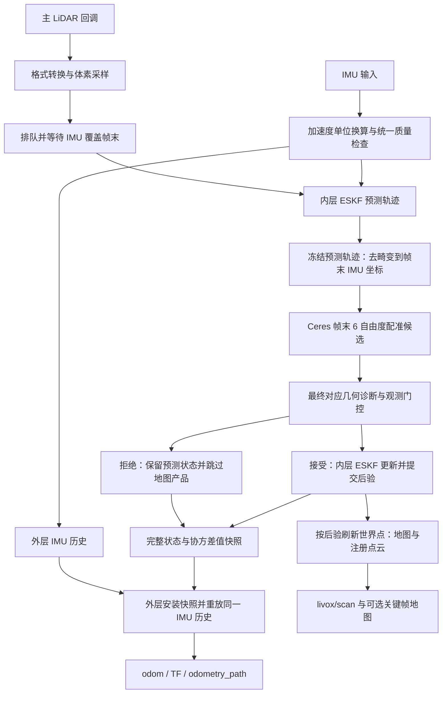

# Adaptive-LIO 独立测试工作空间

这个工作空间用于测试 ECUST Origin Sentry 当前改造版 Adaptive-LIO。它保留 LiDAR + IMU 里程计、编译所需的 Livox 消息依赖、RViz 配置和跑包脚本，可以独立编译与测试。仓库分支为 `ljb`。

本地目录为 `/home/lyu/real/adalio_test_ws`。脚本按自身所在位置查找工作空间，克隆或移动到其他目录后也可使用。测试 rosbag 已复制到本地，但通过 `.gitignore` 排除，不上传到 GitHub；克隆仓库后需要自行准备数据。

## 1. 文件与功能包

```text
adalio_test_ws/
├── README.md
├── .gitignore
├── start_bag_odometry.sh       # 启动 Adaptive-LIO 与跑包 RViz
├── play_bag_163.sh             # 回放 163 主雷达及其 IMU
├── bag_odometry.rviz           # 点云、轨迹、Odometry、TF 显示
├── src/
│   ├── Adaptive-LIO/
│   │   ├── CMakeLists.txt / package.xml
│   │   ├── config/             # 传感器、外参、滤波与匹配配置
│   │   ├── launch/             # ROS 2 节点启动入口
│   │   ├── src/                # 里程计实现
│   │   ├── thirdparty/         # Sophus、robin-map 等头文件依赖
│   │   ├── test/               # 确定性测试与用户回放检查工具
│   │   ├── docs/               # 点/状态契约、质量策略、改造报告
│   │   └── validation/         # 历史实现与验证记录
│   └── livox_ros_driver2/      # CustomMsg/CustomPoint 消息及驱动源码
├── rosbag2_2026_07_07-16_37_53/ # 仅本地：metadata.yaml 与 MCAP
└── build/ install/ log/        # 编译生成，不上传
```

| ROS 包 | 用途 | 跑包时是否启动 |
|---|---|---|
| `adaptive_lio` | IMU 预测、点云去畸变、Ceres 配准、ESKF 更新、里程计与点云输出 | 是 |
| `livox_ros_driver2` | 提供包内记录使用的 `CustomMsg` / `CustomPoint` 类型；附带 Livox SDK 库 | 否；跑包只使用它生成的消息类型 |

这里没有复制导航、决策或底盘控制程序。`Adaptive-LIO/src/scantext_module` 是包内部的可选关键帧/地图模块，默认关闭。

## 2. 设计架构与数据流

当前实现使用内、外两层 ESKF。内层接收 LiDAR 配准观测，是权威后验；外层接收完整状态快照并重放 IMU，用于输出及时的 `/odom` 和 TF。



### 时间与点坐标

Livox 点内 `offset_time` 从纳秒转换为秒，并与消息头时间相加得到点采样时间。LiDAR、IMU、帧首和帧末均使用传感器时间；耗时统计另外使用主机单调时钟。

每个点保留原始 `raw_point` 和采样时间。`DeskewToEndImu` 使用冻结的 IMU 预测轨迹，将它转换为帧末 IMU 坐标下的 `end_point`。Ceres 只优化帧末位姿，不再次通过 `alpha_time` 做插值去畸变。成功更新内层滤波器后，世界点按后验位姿统一刷新，再用于地图和发布。

种子帧用有效预测状态初始化地图，不伪造 LiDAR 观测。被拒绝的帧保留预测状态，不更新地图、关键帧或注册点云，也不推进最近接受帧时间。外层接收的是完整快照，包含导航状态、重力、18×18 协方差和传播配置；随后按相同 IMU 处理策略重放。

### 主要源码入口

| 文件或目录，均相对 `src/Adaptive-LIO/` | 作用 |
|---|---|
| `src/apps/main_ada.cpp` | ROS 订阅、传感器转换、工作线程、点云及标量发布 |
| `src/preprocess/cloud_convert/` | Livox 与标准点云格式转换、点时间生成 |
| `src/lio/lidarodom.cpp` | 帧同步、预测、去畸变、配准与后验提交事务 |
| `src/algo/point_time.h` | 点时间覆盖检查、去畸变到帧末 |
| `src/lio/lidarFactor.h` | Ceres 点到平面残差 |
| `src/algo/eskf.hpp` | ESKF 预测与 SE(3) 观测更新 |
| `src/algo/lidar_geometry_quality.h` / `lidar_observation.h` | 最终对应几何谱与秩、完整 6×6 观测协方差 |
| `src/algo/lidar_sampling.h` | 按空间及法向分桶选择配准候选 |
| `src/algo/imu_quality.h` | 统一 IMU 有效性、量程与短时保持策略 |
| `src/algo/imu_odom_predictor.h` / `src/apps/imu_odom_output.h` | 外层快照安装、IMU 重放与唯一 odom/TF 输出 |
| `src/common/timer/` | 阶段耗时与主雷达逐帧总耗时统计 |

## 3. 环境与依赖

当前验证环境为 Ubuntu 24.04、ROS 2 Jazzy、GCC 13，使用 C++17；已安装 Eigen 3.4、PCL 1.14、OpenCV 4.6、Ceres 2.2、yaml-cpp 0.8。CMake 查找系统安装的 Ceres 2.x，不要求固定 `/opt/ceres-2.2` 路径。

先安装并配置 ROS 2 Jazzy 的 apt 软件源和基础环境，再安装构建、数学库及 ROS 依赖：

```bash
sudo apt update
sudo apt install -y \
  build-essential cmake git python3-colcon-common-extensions python3-rosdep \
  libeigen3-dev libpcl-dev libceres-dev libgoogle-glog-dev libgflags-dev \
  libyaml-cpp-dev libopencv-dev libsuitesparse-dev libapr1-dev \
  ros-jazzy-desktop ros-jazzy-ament-cmake-auto \
  ros-jazzy-ament-lint-auto ros-jazzy-ament-lint-common \
  ros-jazzy-pcl-conversions ros-jazzy-tf2-geometry-msgs \
  ros-jazzy-message-filters ros-jazzy-rosidl-default-generators \
  ros-jazzy-rosbag2 ros-jazzy-rosbag2-storage-mcap
```

主要 ROS 接口依赖包括 `rclcpp`、`rclcpp_components`、`sensor_msgs`、`nav_msgs`、`geometry_msgs`、`std_msgs`、`std_srvs`、`tf2_ros`、`pcl_conversions` 和 `livox_ros_driver2`。Livox 包携带 SDK 头文件及对应架构的库，构建时选择 amd64、arm64 或 riscv64 版本；实际独立构建验证以当前 amd64 环境为准。

可用 `rosdep` 补齐包清单中的系统依赖；第一次使用时初始化一次，之后更新并安装：

```bash
# 仅未初始化 rosdep 的机器需要执行：sudo rosdep init
rosdep update
source /opt/ros/jazzy/setup.bash
rosdep install --from-paths src --ignore-src -r -y --rosdistro jazzy
```

上面的显式库安装列表用于覆盖当前包清单尚未完整声明的 Ceres、glog、gflags、OpenCV 和 SuiteSparse 依赖。

## 4. 克隆与独立编译

```bash
git clone --branch ljb https://github.com/ECUST-Origin-Sentry-Team/Adaptive-LIO.git adalio_test_ws
cd adalio_test_ws
source /opt/ros/jazzy/setup.bash
CMAKE_BUILD_PARALLEL_LEVEL=2 colcon build --symlink-install \
  --packages-up-to adaptive_lio --cmake-args -DBUILD_TESTING=ON
source install/setup.bash
```

`--packages-up-to adaptive_lio` 会先构建本工作空间的 `livox_ros_driver2`，再构建里程计。首次构建前只需 source ROS Jazzy；不需要 source 原导航工作空间。应在打开的新终端中构建，避免旧工作空间的环境覆盖。

## 5. 默认配置与 ROS 接口

默认参数文件是 `src/Adaptive-LIO/config/mapping_m.yaml`。

| 配置 | 当前值或用途 |
|---|---|
| `common.lid_topic` | `/livox/lidar_192_168_1_163` |
| `common.imu_topic` | `/livox/imu_192_168_1_163` |
| `common.gnorm` | `9.805`，将当前 Livox IMU 的 g 单位加速度转换为 m/s² |
| `preprocess.sweep_cut_num` | `1`，当前测试每个主 LiDAR 消息作为一个处理帧 |
| `delay_time` | 默认 `0.05` 秒，等待 IMU 覆盖及额外余量 |
| `odometry.point_time_model` | `IMU_DESKEW_END`，统一帧末去畸变路径 |
| `odometry.lidar_covariance_mode` | `fixed`，固定 `0.01 I₆` 观测方差；自适应模式保留为实验选项 |
| `aux_lidar.enable_bundle_fusion` | `false`，且默认未配置副雷达订阅 |
| `mapping_module.enable_mapping` | `false`，默认关闭 ScanContext 地图模块 |
| `imu_quality.hold_seconds` | `0`，默认不启用异常 IMU 的短时保持 |
| `common.fusion_aft_to_base_xyzrpy` | `aft_mapped → base_link` 外参；换机器时按实际安装检查 |

`mapping_m_low_delay.yaml` 提供 `delay_time: 0.0` 的配置供用户对照测试；应分别记录等待与处理耗时。IMU 量程、LiDAR/IMU 外参和加速度单位需要与真实输入一致，自适应观测协方差与 IMU 保持参数尚未完成传感器标定，默认不开启。

| 输出 | 消息类型或 TF 关系 | 数据来源 |
|---|---|---|
| `/odom` | `nav_msgs/msg/Odometry`，`odom` / `aft_mapped` | 外层重放后的状态，携带 pose/twist 协方差 |
| `/tf` | `odom → aft_mapped → base_link` | 与 odom 同状态时间的位姿及配置外参 |
| `/odometry_path` | `nav_msgs/msg/Path` | 有订阅者时发布，路径最多保留配置中的 300 个点 |
| `/livox/scan` | `sensor_msgs/msg/PointCloud2` | 接受/种子帧的后验注册点云，异步发布 |
| `/velocity`、`/move_dist` | `std_msgs/msg/Float32` | 保留的低频标量输出 |
| `/save_map_service` | `std_srvs/srv/Trigger` | 地图模块启用后的异步保存入口 |

该工作空间不提供 `map → odom` 全局定位关系，跑包 RViz 固定坐标系为 `odom`。

## 6. 用户自行跑包

本地复制的包位于工作空间根目录 `rosbag2_2026_07_07-16_37_53/`，包含 `metadata.yaml` 和原始 `.mcap` 文件。它约 277.5 秒，记录 160/163 两台 LiDAR 的点云与 IMU；当前回放脚本只选择 163 主雷达和它的 IMU。

克隆后可将数据目录放到同名位置，或把其他数据路径传给 `play_bag_163.sh`。

终端 1，先启动里程计和 RViz：

```bash
cd /path/to/adalio_test_ws
./start_bag_odometry.sh
```

终端 2，开始回放：

```bash
cd /path/to/adalio_test_ws
./play_bag_163.sh
# 或使用另一个数据目录（仍需包含脚本选择的 163 话题）：
./play_bag_163.sh /absolute/path/to/rosbag_directory
```

程序需要数据完成 IMU 初始化；启动后另一终端即可开始播放，等待日志出现 `init successful` 后再观察正式里程计输出。播放速率为 1 倍，发布 `/clock`；RViz 启用 `use_sim_time`。空格暂停/继续；Ctrl+C 停止对应脚本。更换话题名称时，同时修改 YAML 输入话题和回放脚本的 `--topics`。

查看数据和输出可使用：

```bash
ros2 bag info /absolute/path/to/rosbag_directory
source /opt/ros/jazzy/setup.bash
source install/setup.bash
ros2 topic hz /odom
ros2 topic hz /livox/scan
ros2 topic echo /odom --once
ros2 run tf2_ros tf2_echo odom aft_mapped
```

跑包时不必启动 Livox 硬件驱动。实时传感器输入可单独启动驱动并使用包内 launch；`run.launch.py` 当前只启动里程计，跑包 RViz 由根目录脚本单独启动。

### RViz 默认显示

`bag_odometry.rviz` 显示 Grid、`/livox/scan` 点云、`/odometry_path` 轨迹、`/odom` 和 TF。`LIO Odometry` 使用 Arrow，轴长 `0.1 m`、轴半径 `0.01 m`、头长 `0.03 m`、头半径 `0.01 m`；保留 100 个姿态，位置/角度容差均为 `0.1`。`Covariance` 可视化默认关闭，但 `/odom` 消息仍保留协方差数据。

## 7. 不跑包的测试

完成独立构建后，从工作空间根目录运行五组确定性测试：

```bash
source /opt/ros/jazzy/setup.bash
source install/setup.bash
ctest --test-dir build/adaptive_lio \
  -R '^adaptive_lio_(core|geometry|registration|pipeline|imu_quality)$' \
  --output-on-failure
```

| 测试 | 覆盖内容 |
|---|---|
| `core` | 状态快照、传播、坐标投影、双层重放、历史/超时、主副雷达时间裁剪 |
| `geometry` | 固定协方差等价、完整 SPD 矩阵门控/更新、几何秩与分桶覆盖 |
| `registration` | 静止/平移/旋转/组合运动去畸变、外参、点时间覆盖、实际 Ceres 因子雅可比 |
| `pipeline` | 真实帧处理中的种子、接受、拒绝、恢复与地图/发布一致性 |
| `imu_quality` | NaN、削顶、时间异常、默认故障处理、有限保持与重放一致性 |

也可以在包目录独立运行部分测试，核心脚本不依赖 ROS，配准脚本需要 Ceres：

```bash
cd src/Adaptive-LIO
bash test/run_core_tests.sh
bash test/run_registration_tests.sh
```

`src/Adaptive-LIO/test/replay_smoke.py` 是用户可选的回放一致性工具，运行它会实际启动 bag 和里程计；本次工作空间准备不自动执行它。可先查看参数：

```bash
python3 src/Adaptive-LIO/test/replay_smoke.py --help
```

测试证明的是实现一致性；无真值 bag、RViz 轨迹连续或测试通过均不能单独证明绝对定位精度提升。

本测试空间在 2026-10-10 的验证结果：只使用 ROS 2 Jazzy 基础环境独立构建，两个包编译成功；上表五组 CTest 全部通过。运行库指向本工作空间，rosbag 副本的 SHA-256 与原始数据一致，两个启动脚本通过 Bash 语法检查。本次没有执行 bag 回放；编译保留了现有源码和第三方库警告。

## 8. 日志与计时解释

正常退出时，节点打印均值并写入 `src/Adaptive-LIO/Log/log_time.txt`。运行前保持该目录可写。计时包含所有完成处理的主雷达帧，包括初始化期间进入处理函数的帧；尚在队列中或在入口被丢弃的帧不计入。

- `frame_callback_to_done`：每个主雷达处理帧从点云回调入口到 LIO 处理返回的墙钟耗时，包含转换、降采样、队列等待和 IMU 同步等待；不包含进入回调前的消息传递以及之后的异步点云发布。
- `processMeasurement`：只统计 LIO 帧处理函数。
- `optimize`、`predict` 等：各阶段调用耗时；调用次数不一定等于总帧数，不能直接把这些均值相加当成逐帧总耗时。
- `lio_quality`：接受/拒绝状态、支持数、代价、最终对应几何秩、观测模式与候选/后验差异。
- `imu_output`：外层重放、状态历史、超时与 IMU 质量统计。

`deskew_uncovered_or_invalid=N` 表示这一帧有 N 个点因时间覆盖不足或数据无效被剔除。相邻 LiDAR 帧有短时间重叠时，部分帧首点可能早于当前预测轨迹起点；程序继续处理其他点。该警告本身不是整帧成功/失败结论，应结合 `lio_quality` 的 `accepted` 与 `reason` 判断。

bag 播放完后 IMU 不再输入，出现 `IMU input interrupted` 提示符合输入停止的情况。节点若出现持续缺失历史、IMU 传播故障或队列溢出，应检查数据时间与输入状态，并重新启动整个里程计节点。

## 9. 上传范围与原项目说明

Git 上传源代码、SDK 依赖、配置、RViz、脚本和文档。`rosbag*`、`.mcap`、`.db3`、`build/`、`install/`、`log/` 及运行计时输出均已忽略；本地数据复制不会影响上传。

上游项目介绍与作者引用保留在 [Adaptive-LIO 包 README](src/Adaptive-LIO/README.md) 中。当前实现细节见 [点与状态契约](src/Adaptive-LIO/docs/point_state_contract.md)、[几何与协方差](src/Adaptive-LIO/docs/geometry_covariance.md)、[IMU 质量与重放](src/Adaptive-LIO/docs/imu_quality.md) 及 [论文对照改造报告](src/Adaptive-LIO/docs/paper_alignment_report_2026-10-10.md)。历史报告中的完整导航工程路径是当时记录；本测试空间以本文的相对目录和命令为准。
