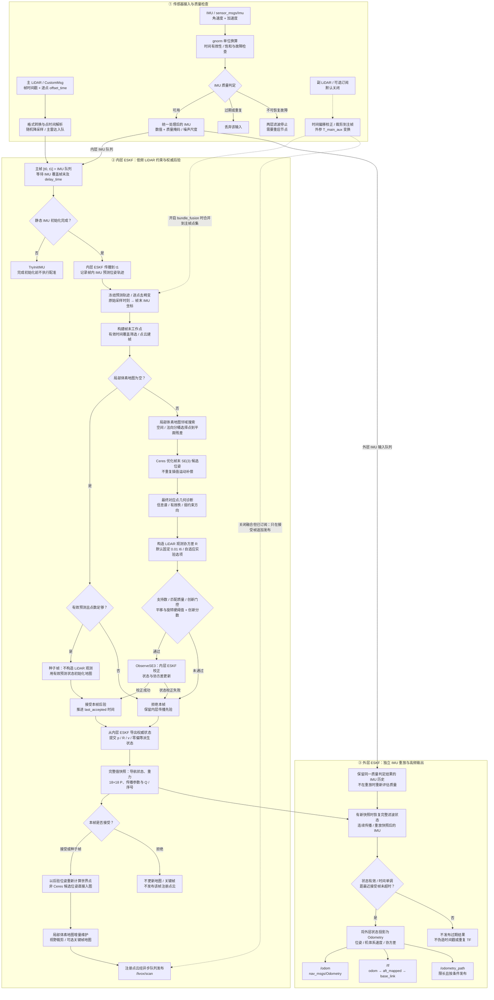

# Adaptive-LIO

**面向 RoboMaster 哨兵机器人的 LiDAR–IMU 里程计 | ROS 2 Jazzy**

[](https://docs.ros.org/en/jazzy/)
[](https://ubuntu.com/)
[](https://isocpp.org/)
[](https://ieeexplore.ieee.org/document/10806842)

> 本仓库是基于 [原版 Adaptive-LIO](https://github.com/chengwei0427/Adaptive-LIO) 的工程化改造版本，主要用于 ECUST Origin Sentry 的 LiDAR–IMU 里程计开发与独立验证。**它不是原论文的逐行复现，也不包含完整导航、全局定位或底盘控制系统。**
>
> 当前默认分支为 `ljb`；下文所述均以该分支配置与源码为准。

## 项目概览

该系统以 **LiDAR 几何观测约束漂移、IMU 高频传播提供及时运动状态** 为核心思路，采用内外双层 ESKF 数据流：

- **内层 ESKF（权威后验）**：IMU 传播 → 点云去畸变 → Ceres 帧末位姿配准 → 观测质量门控 → ESKF 校正；只有被接受的观测才能更新地图。
- **外层 ESKF（高频输出）**：安装内层提供的完整状态与协方差快照，重放快照之后的 IMU 历史，为 `/odom` 和 TF 提供连续状态。
- **点与时间语义统一**：使用传感器时间；逐点去畸变到当前 LiDAR 帧末 IMU 坐标；Ceres 只估计帧末位姿，不重复执行旧式插值补偿。
- **工程诊断**：保留几何退化分析、完整 6×6 观测协方差实验路径、IMU 质量检查，以及分阶段耗时和逐帧处理耗时统计。

**当前默认状态**：纯 LiDAR + IMU；主雷达工作，副雷达融合关闭；固定 LiDAR 观测协方差；ScanContext 关键帧地图模块关闭；异常 IMU 的短时保持关闭。实验选项存在不等于已完成真实数据标定或实车验收。

### 系统数据流

下图按照实际运行线程分为三个部分：**传感器接入与同步、内层 LiDAR–IMU 融合、外层高频 IMU 里程计输出**。实线表示默认数据路径，虚线表示可选的副雷达路径。内层的 LiDAR 更新与外层的 IMU 传播并行进行，并不是逐帧串行等待地图发布。



**读图提示：**种子帧只利用已验证的 IMU 预测状态初始化地图，不执行 `ObserveSE3`；匹配拒绝帧依然向外层发送内层传播状态的完整快照，但**不更新地图，也不发布该帧的注册点云**。外层只从已安装的权威快照向后进行 IMU 传播，不会对同一 LiDAR 候选观测做第二次融合。`/odom`、TF 和 Path 来自外层；局部地图与 `/livox/scan` 来自内层。副雷达相关虚线在默认配置下不激活。

## 快速开始

### 1. 环境

当前独立构建基线为 **Ubuntu 24.04 + ROS 2 Jazzy + C++17**，使用 Eigen、PCL、Ceres 2.x、glog、gflags、yaml-cpp 等。需要先按 [ROS 2 Jazzy 安装文档](https://docs.ros.org/en/jazzy/Installation.html) 配置 ROS 环境。

```bash
sudo apt update
sudo apt install -y \
  build-essential cmake git python3-colcon-common-extensions python3-rosdep \
  libeigen3-dev libpcl-dev libceres-dev libgoogle-glog-dev libgflags-dev \
  libyaml-cpp-dev libopencv-dev libsuitesparse-dev \
  ros-jazzy-ament-cmake-auto ros-jazzy-pcl-conversions \
  ros-jazzy-tf2-geometry-msgs ros-jazzy-message-filters \
  ros-jazzy-rosbag2 ros-jazzy-rosbag2-storage-mcap
```

仓库 `src/livox_ros_driver2/` 提供 `livox_ros_driver2` 消息类型和驱动源码；**回放已有 rosbag 时不需要启动硬件驱动**。在目标机器上还需要匹配相应架构的 Livox SDK 库。

### 2. 获取并编译

```bash
git clone --branch ljb https://github.com/ECUST-Origin-Sentry-Team/Adaptive-LIO.git adalio_ws
cd adalio_ws
source /opt/ros/jazzy/setup.bash

# 已初始化 rosdep 的机器：
rosdep update
rosdep install --from-paths src --ignore-src -r -y --rosdistro jazzy

CMAKE_BUILD_PARALLEL_LEVEL=2 colcon build --symlink-install \
  --packages-up-to adaptive_lio --cmake-args -DBUILD_TESTING=ON
source install/setup.bash
```

首次使用 `rosdep` 但尚未初始化时，先运行 `sudo rosdep init`。构建建议在**未 source 其他 ROS 工作空间**的新终端中进行，防止同名依赖和消息定义冲突。`--packages-up-to` 会连同需要的 `livox_ros_driver2` 一起构建。

### 3. 实时运行

先确认传感器驱动正在发布 YAML 中配置的话题，然后在已 source 的终端执行：

```bash
ros2 launch adaptive_lio run.launch.py
```

修改配置时可以指定绝对路径：

```bash
ros2 launch adaptive_lio run.launch.py \
  adaptive_lio_cfg_dir:="$(pwd)/src/Adaptive-LIO/config/mapping_m.yaml"
```

注意：当前 `run.launch.py` **只启动 Adaptive-LIO 节点**，不自动启动 Livox 驱动或 RViz；即使声明了 `rviz` 参数，RViz 节点也没有添加到 LaunchDescription。需要可视化时另行运行 `rviz2`。

### 4. 录制数据回放

仓库**不包含**原始 rosbag。根目录脚本默认面向 163 号主雷达的点云与 IMU：

| 终端 | 命令 | 功能 |
|---|---|---|
| A | `./start_bag_odometry.sh` | 启动 LIO 与配置好的 RViz（RViz 使用仿真时间） |
| B | `./play_bag_163.sh /absolute/path/to/rosbag_directory` | 以 1 倍速回放主雷达与 IMU，并发布 `/clock` |

如果数据放在仓库根目录下的 `rosbag2_2026_07_07-16_37_53/`，终端 B 可以省略路径。脚本会检查 `metadata.yaml` 是否存在；输入数据至少需要含有：

```text
/livox/lidar_192_168_1_163
/livox/imu_192_168_1_163
```

更换设备或 bag 时，**同时检查** `config/mapping_m.yaml` 中的话题及 `play_bag_163.sh` 中的 `--topics` 列表。播放前用 `ros2 bag info /path/to/bag` 确认消息类型与时间范围。初始化阶段需有足够有效 IMU 数据；正式工作后日志会出现 `init successful`。

## ROS 接口和坐标系

| 方向 | 接口 | 类型 / 说明 |
|---|---|---|
| 订阅 | `common.lid_topic` | 主 LiDAR 点云；默认 `/livox/lidar_192_168_1_163` |
| 订阅 | `common.imu_topic` | IMU；默认 `/livox/imu_192_168_1_163` |
| 发布 | `/odom` | `nav_msgs/msg/Odometry`；外层 IMU 重放后的状态，包含位姿、速度相关信息与协方差 |
| 发布 | `/tf` | `odom → aft_mapped → base_link` |
| 发布 | `/odometry_path` | `nav_msgs/msg/Path`；有限长度历史轨迹 |
| 发布 | `/livox/scan` | `sensor_msgs/msg/PointCloud2`；被接受或初始化种子帧对应的注册点云 |
| 发布 | `/velocity`、`/move_dist` | `std_msgs/msg/Float32`；保留的标量诊断输出 |
| 服务 | `/save_map_service` | `std_srvs/srv/Trigger`；与可选地图模块关联 |

**坐标系职责**：`odom` 为本地连续里程计参考系；`aft_mapped` 是里程计跟踪的 IMU 相关状态坐标系；`base_link` 通过配置外参连接到车体。默认外参在 `common.fusion_aft_to_base_xyzrpy`，需按传感器安装和整车 TF 规划重新标定。**本包不发布 `map → odom`**，因此接入 Nav2、GICP 重定位或其他全局定位器时，必须由外部模块负责该变换，不应额外重复发布 `odom → base_link`。

基础检查命令：

```bash
ros2 topic hz /odom
ros2 topic echo /odom --once
ros2 topic hz /livox/scan
ros2 run tf2_ros tf2_echo odom aft_mapped
```

## 核心算法与状态一致性

### LiDAR 帧处理

1. 从主雷达消息生成点时间，保留原始点与采样时间；使用 **传感器时间**，而非回调到达的主机时间，计算运动补偿。
2. IMU 完成对应时间窗口的预测后，将点去畸变到**当前帧末 IMU 坐标系**；时间未覆盖或无效的点明确剔除。
3. 依据局部地图构建点到平面残差，Ceres 优化**帧末 6 自由度候选位姿**；按空间与法向分桶采样，避免仅依赖输入点顺序。
4. 根据支持数量、几何约束、创新等判定候选是否可靠。通过门控的候选作为 SE(3) 观测校正内层 ESKF，并用已提交的后验刷新世界点；失败则保留传播先验，跳过本帧地图产品。
5. 将完整内层快照发送给外层，包括导航状态、重力、18×18 协方差、传播配置和噪声信息；外层按同一 IMU 质量策略重放后续历史以产生及时输出。

这套设计**不是滑窗优化或全局因子图**。ScanContext 代码仍在仓库中，但默认不启动其地图工作线程，也不等于当前已经启用回环校正或全局重定位。

### IMU 质量与协方差

IMU 数据进入系统时统一进行单位换算和有效性检查。默认 `imu_quality.hold_seconds: 0`：检测到不可恢复的无效测量或已配置量程下的饱和故障时，系统采取保守的故障停止策略；短时轴保持是实验选项，**未经过具体传感器标定，不应直接在实车启用**。

LiDAR 观测协方差默认 `odometry.lidar_covariance_mode: fixed`。`adaptive` 几何退化感知模式已实现，但尺度、相关性膨胀和接受率尚需要独立数据校准。任何合成测试结果都不应等同于已证明实际里程计精度提升。

## 配置指南

默认配置：[`src/Adaptive-LIO/config/mapping_m.yaml`](src/Adaptive-LIO/config/mapping_m.yaml)；低等待时间对照：[`mapping_m_low_delay.yaml`](src/Adaptive-LIO/config/mapping_m_low_delay.yaml)。两者主要差别是 `delay_time`（分别为 **0.05 s** 与 **0.0 s**）。

| 配置键 | 默认值 | 含义 / 使用提示 |
|---|---|---|
| `common.lid_topic` / `common.imu_topic` | 163 设备话题 | 首先核对实际输入，设备不同必须修改 |
| `common.gnorm` | `9.805` | 按当前数据的 g 单位加速度换算为 m/s²；不要对已为 m/s² 的数据重复缩放 |
| `common.fusion_aft_to_base_xyzrpy` | 仓库预设外参 | `aft_mapped → base_link` 的安装变换；换车必须重检 |
| `preprocess.sweep_cut_num` | `1` | 当前测试按主雷达完整消息处理 |
| `delay_time` | `0.05` s | 等待 IMU 覆盖后的额外时间策略；`0.0` 需同包实测对照 |
| `odometry.point_time_model` | `IMU_DESKEW_END` | 唯一有效的当前点时间处理路径 |
| `odometry.lidar_covariance_mode` | `fixed` | `adaptive` 仍属于未校准实验配置 |
| `odometry.max_num_residuals` | `500` | Ceres 残差预算上限 |
| `aux_lidar.enable_bundle_fusion` | `false` | 主副雷达联合匹配默认关闭，副雷达话题默认不订阅 |
| `mapping_module.enable_mapping` | `false` | 默认关闭可选 ScanContext/关键帧地图模块 |
| `imu_quality.hold_seconds` | `0.0` | 默认不做异常 IMU 轴保持 |

旧版 `icpmodel`、`motion_compensation`、`point_to_plane_with_distortion` 等不再是可切换的有效运行配置。对照旧工程迁移时，应以当前 YAML 和 [`point_state_contract.md`](src/Adaptive-LIO/docs/point_state_contract.md) 为准，不要直接复制早期参数。

## 代码结构

```text
.
├── README.md                     # 本文档
├── start_bag_odometry.sh         # LIO + RViz 跑包入口
├── play_bag_163.sh               # 163 主雷达数据回放
├── bag_odometry.rviz             # 可视化配置
└── src/
    ├── Adaptive-LIO/
    │   ├── config/               # 传感器与算法参数
    │   ├── launch/               # ROS 2 启动文件
    │   ├── src/
    │   │   ├── apps/             # ROS 订阅、发布和高频输出
    │   │   ├── preprocess/       # 点云转换、逐点时间
    │   │   ├── lio/              # 配准、滤波状态提交与局部地图
    │   │   ├── algo/             # ESKF、IMU 质量、几何门控、去畸变
    │   │   ├── scantext_module/  # 可选 ScanContext 相关模块
    │   │   └── common/           # 配置、地图与性能统计
    │   ├── test/                 # 确定性测试与回放检查工具
    │   ├── docs/                 # 算法约定、改造与分析报告
    │   └── validation/           # 构建、回归与历史验证记录
    └── livox_ros_driver2/        # Livox 消息与驱动依赖
```

建议从 [`main_ada.cpp`](src/Adaptive-LIO/src/apps/main_ada.cpp) 阅读节点接口，然后看 [`lidarodom.cpp`](src/Adaptive-LIO/src/lio/lidarodom.cpp) 的帧处理事务，接着读 [`eskf.hpp`](src/Adaptive-LIO/src/algo/eskf.hpp)、[`imu_odom_predictor.h`](src/Adaptive-LIO/src/algo/imu_odom_predictor.h) 及 [`imu_odom_output.h`](src/Adaptive-LIO/src/apps/imu_odom_output.h)。

## 测试与验证边界

构建时使用 `-DBUILD_TESTING=ON`，然后运行：

```bash
ctest --test-dir build/adaptive_lio \
  -R '^adaptive_lio_(core|geometry|registration|pipeline|imu_quality)$' \
  --output-on-failure
```

五组测试覆盖状态快照与 IMU 重放、几何信息矩阵、Ceres 因子和去畸变、种子/接受/拒绝事务、IMU 质量与故障边界。若需要脱离 rosbag 的源码级检查，也可运行：

```bash
bash src/Adaptive-LIO/test/run_core_tests.sh
bash src/Adaptive-LIO/test/run_registration_tests.sh
```

仓库中存有 **2026-10-10 改造阶段** 的验证记录：当时最终 R6 代码通过编译和五组确定性 CTest，但**最终 R6 版本没有继续执行完整 bag/实车验收**。`validation/` 中的历史回放结果和计时不能直接当成当前任何新参数或代码修改后的性能结论。详见 [论文对照改造报告](src/Adaptive-LIO/docs/paper_alignment_report_2026-10-10.md)。

### 性能日志如何理解

`frame_callback_to_done` 是主 LiDAR 回调进入后至 LIO 处理返回的单帧墙钟统计，包含点转换、队列等待和 IMU 同步等待；**不包含回调前传输及回调返回后的异步发布**。`processMeasurement` 是 LIO 处理内部耗时。`predict` / `optimize` 等阶段的样本数可能不同，**不能直接相加各阶段平均值作为一帧总耗时**。回放和设备的传感器时间用于状态估计；耗时计时使用主机单调时钟，二者不可混作延迟测量。

遇到 `deskew_uncovered_or_invalid=N` 时，表示该帧有 N 个点因时间覆盖不足或无效被丢弃，**不等价于整帧配准失败**；还需结合 `lio_quality` 中的接受状态和原因判断。

## 已知限制

- 该仓库提供**局部里程计**，不提供闭环全局图优化、`map → odom` 全局定位或 Nav2 整套导航功能。
- 主副雷达联合匹配、ScanContext 地图、自适应 LiDAR 协方差、IMU 短时保持均不是默认工作配置。
- 当前外参与 IMU 单位换算针对特定设备和驱动发布约定。移植时须核对**原始消息语义**，不可直接复用数值。
- 通过单元测试与 RViz 轨迹连续，不等于完成精度、退化鲁棒性、延迟预算或实车安全性验收。
- 当前缺少随仓库分发的公开标准数据集与定量 A/B 精度结果，因此不作未证实的性能领先声明。

## 技术文档

深入阅读可参考 [点与状态契约](src/Adaptive-LIO/docs/point_state_contract.md)、[几何与观测协方差](src/Adaptive-LIO/docs/geometry_covariance.md)、[IMU 质量与重放](src/Adaptive-LIO/docs/imu_quality.md)、[完整改造报告](src/Adaptive-LIO/docs/paper_alignment_report_2026-10-10.md)、[测试说明](src/Adaptive-LIO/test/README.md)。

## 上游与致谢

本项目在原版 **Adaptive-LIO: Enhancing Robustness and Precision through Environmental Adaptation in LiDAR Inertial Odometry** 基础上进行工程化开发。原版作者、论文、历史实验与原始开源许可应以[上游仓库](https://github.com/chengwei0427/Adaptive-LIO)和本项目的 [`src/Adaptive-LIO/README.md`](src/Adaptive-LIO/README.md) 为准。

- 原始项目：[chengwei0427/Adaptive-LIO](https://github.com/chengwei0427/Adaptive-LIO)
- 论文：[IEEE Xplore](https://ieeexplore.ieee.org/document/10806842) · [arXiv](https://arxiv.org/abs/2503.05077)
- 工程维护：**ECUST Origin Sentry Team**

如在自己的研究中使用原始算法，请引用原论文；使用本工程改造版本时，请同时注明本仓库及所使用的分支或提交版本。
